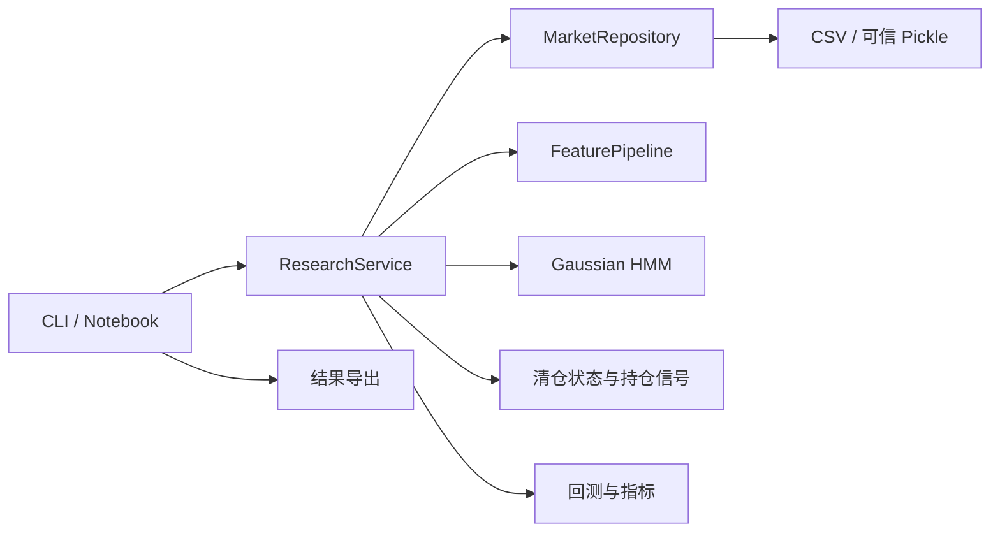

# 架构与扩展

## 依赖方向



`config` 与 `exceptions` 提供共同契约；计算模块不读取命令行、不查找数据文件、不修改全局绘图样式。服务层编排依赖，不包含文件路径模板和重复的指标公式。文件读取只发生在显式调用时，导入包不会启动实验。

对应熟悉的 Java 分层：`AppConfig` 类似不可变配置 DTO；`MarketRepository` 是仓储接口（Python Protocol）；`ResearchService` 是应用服务；CLI 是装配入口。使用构造函数注入仓储，而非全局单例或服务定位器。保持 Python 的简洁性，不为每个纯函数创建接口或工厂。

## 核心流程

1. 读取 TOML 和环境变量，校验枚举、数值范围、交叉约束；冻结配置。
2. 数据层规范日期和字段，在共同日期范围内严格校验交易日一致性。
3. 计算只依赖当前及历史观测的特征，保留预热所产生的空值。
4. 按不重叠测试窗口滚动训练，每个训练窗口独立拟合 PowerTransformer、StandardScaler、PCA 和 HMM。
5. 用训练窗口内的下一日指数收益识别应清仓的状态，训练末日没有下一日训练收益，不参与此映射。
6. 样本外通过前向过滤逐日识别状态；使用训练末尾后验初始化当前模型的测试段，模型重新训练时重新初始化。
7. 汇总一次信号后整体滞后一天形成持仓；窗口交界处保持上一日信号，不人为重置仓位。
8. 导出最终配置、窗口诊断、逐日收益及指标。HMM 不收敛日志保留；数据和模型失败给出上下文。

## Python API

```python
from benke.config.settings import load_settings
from benke.services.research import ResearchService

config = load_settings('configs/default.toml')
result = ResearchService(config).run()
print(result.metrics)
```

已有 DataFrame 时使用 `ResearchService(config).run_frames(derivatives, benchmark)`。此方法处理传入的完整区间；`data.start/end` 仅由文件仓储在加载时应用。测试或其他数据源可以注入任何实现 `load_market() -> tuple[DataFrame, DataFrame]` 的对象。

## 扩展步骤

- 新特征：在 `FeatureKind` 增加枚举，在 `features/builder.py` 添加纯函数及字段需求校验并注册到 `BUILDERS`，通过 `FeatureConfig` 配置窗口等参数。添加公式与未来行情扰动测试。
- 新数据源：实现 `MarketRepository`，返回按日期索引的一期货表、一指数表，注入 `ResearchService`；业务层不依赖供应商路径。
- 新信号规则：扩展枚举与策略配置，将规则放入 `strategies`，通过服务层装配；不能通过 `eval` 加载表达式。
- 新回测引擎：在 `backtesting` 实现适配器，消费相同日期索引的 0/1 信号，明确交易时序和费用口径。
- 新参数：在 Pydantic 配置类声明类型、默认值和校验，再更新示例与文档；业务模块不声明同一参数的另一份默认值。

固定的算法常数（如概率归一化的 1、差分的一阶滞后）不属于业务参数。训练长度、信号阈值、资金、成本、状态数、随机种子和绘图尺寸均由配置提供。

## 开发约定

使用显式导入、类型注解、标准日志；不使用通配符导入、全局 warning 屏蔽、裸 `except`、字符串 `eval`。输入数据不就地修改。失败不能伪装为零收益成功实验。可选绘图和 Backtrader 依赖按需导入。

基础安装：`uv sync --locked`；完整开发：`uv sync --locked --extra portfolio --extra plots`。Notebook 内核额外使用 `--extra notebooks`。依赖更新后重新生成并提交 `uv.lock`，执行测试与格式检查。`tests/` 是唯一测试发现目录，历史研究脚本不被误当作测试执行。
